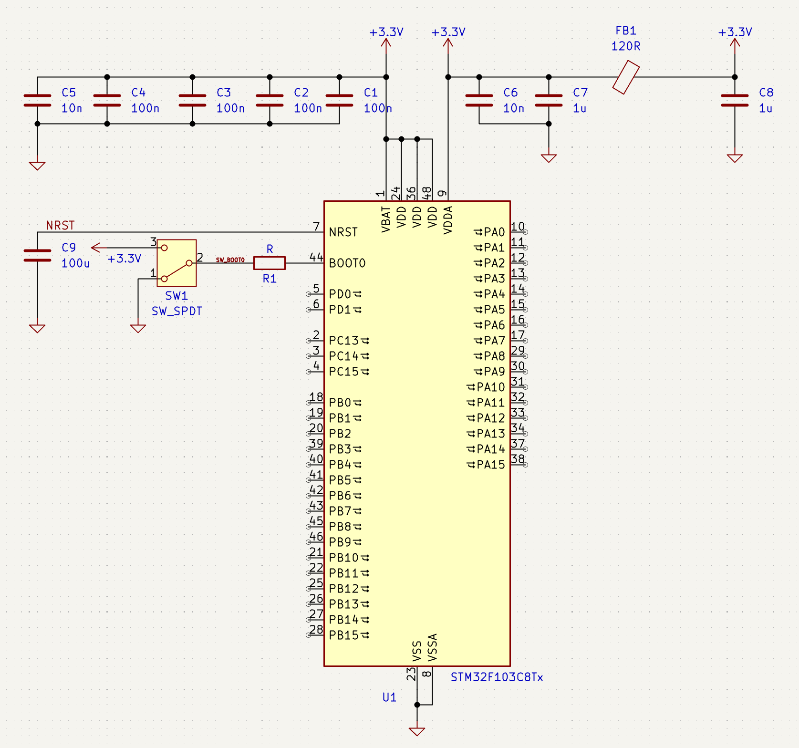

# Power, Reset, and Boot Configuration

The schematic integrates the complete power, decoupling, reset, and boot-mode circuitry required to bring the STM32F103C8Tx microcontroller into a stable and predictable operating state. The additions ensure clean startup behavior, noise-robust supply rails, a reliable manual reset mechanism, and selectable bootloader access for programming over USB or UART.

---

## Decoupling

  

The decoupling network provides broadband noise suppression and stabilizes the MCU’s supply pins.

Multiple capacitors are connected in parallel across the +3.3 V rail:

* Several 100 nF ceramic capacitors positioned close to each VDD pin
* Additional small-value capacitors (10 nF) to suppress high-frequency transients
* Bulk capacitors (1 uF) on both the digital and analog rails
* A ferrite bead separating VDDA from VDD to reduce digital switching noise reaching the ADC domain

This structure minimizes supply impedance across a wide frequency range, reduces jitter, and protects the microcontroller from unstable input voltage during load transients.

---

## NRST conditioning circuit

### Reset capacitor (100 nF)

A **100 nF** capacitor from NRST to ground filters noise on the reset line (ST recommends 0.1 µF in the
STM32F103 datasheet, *Power supply scheme* / *NRST pin protection*). The MCU already contains a power-on and
brown-out reset circuit, so the capacitor does not have to stretch the reset pulse.

!!! danger "Do not use 100 µF on NRST"
    The first schematic of this course (Rev A) had **100 µF** (C9) on NRST. That is a mistake: the internal
    pull-up (30–50 kΩ) needs several seconds to charge it, the debugger's reset pulse cannot discharge it quickly,
    and the reset timing becomes unpredictable. Rev B and Rev C use 100 nF.

### Reset button

A push button from NRST to ground resets the MCU while it is pressed. Releasing it lets the internal pull-up
return NRST to high.

### Internal pull-up

The NRST pin has an internal pull-up resistor, so no external pull-up is needed. NRST is also routed to the
debug connector so the debugger can reset the MCU.

---

## BOOT0 configuration circuit

### Pull-down resistor (10 kΩ)

A 10 kΩ resistor ties BOOT0 to ground, so the STM32F103 boots from internal flash during normal operation.
BOOT1 (PB2) gets its own 10 kΩ pull-down so the boot mode is always defined.

### BOOT0 button

A push button from BOOT0 to +3.3 V selects the system-memory bootloader: hold BOOT0, press and release RESET,
then release BOOT0. (Rev A used a slide switch; buttons cannot be left in the wrong position by accident.)

The STM32F103 system bootloader supports **USART1 only** (PA9/PA10). USB DFU is available only on the
connectivity-line parts (STM32F105/107), so this board is programmed through SWD or USART1.

---

## Summary of function

With the decoupling, reset conditioning, and boot-selection circuitry fully integrated, the system now provides:

* Stable and noise-robust digital and analog supply rails
* A filtered reset line with the internal power-on reset
* Manual reset capability for debugging and firmware testing
* Selectable bootloader access without requiring external tools
* Clearly labeled nets to facilitate PCB layout and signal identification

These additions complete the essential startup infrastructure for the STM32F103C8Tx and establish a solid foundation for reliable operation, firmware development, and future expansion.
