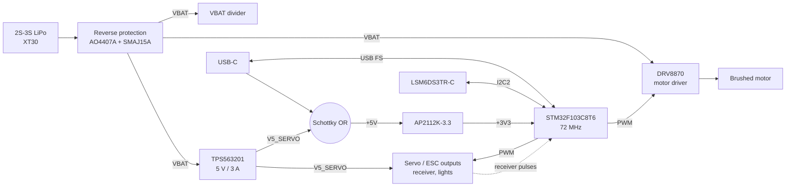

# Project: STM32 RC-Car Controller (Rev C)

The course chapters explain the building blocks of an STM32 board in general. This chapter shows how they come
together in the board that lives in this repository: a complete controller for a small RC car.

## What the board does

| Block | Implementation | MCU resources |
|---|---|---|
| Battery input | 2S–3S LiPo (6–12.6 V) on an XT30 connector, P-MOSFET reverse protection, TVS diode | – |
| Battery monitor | 33 kΩ / 10 kΩ divider | PA4 (ADC1_IN4) |
| Servo rail | TPS563201 synchronous buck, 5.07 V / 3 A for servos and receiver | – |
| Logic supply | servo rail **or** USB-C, each through a Schottky diode, then AP2112K-3.3 | – |
| Motor | DRV8870 H-bridge for a brushed motor, 3.3 A current limit, screw terminal | PA6 / PA7 (TIM3 CH1/CH2) |
| Servo / ESC outputs | 4 × 3-pin headers (signal, 5 V, GND) | PA0–PA3 (TIM2 CH1–CH4) |
| Receiver inputs | 3 × 3-pin headers, 1 kΩ series protection, receiver powered from the servo rail | PB6–PB8 (TIM4 CH1–CH3) |
| Lights | 2 × AO3400A low-side switches, LED supply = 5 V rail | PB0 / PB1 (TIM3 CH3/CH4) |
| IMU | LSM6DS3TR-C accelerometer + gyroscope, I²C address 0x6A, two interrupt lines | PB10 / PB11 (I2C2), PB12 / PB13 |
| USB | USB-C 2.0 device (virtual COM port), USBLC6-2SC6 ESD protection | PA11 / PA12 |
| Debug | Cortex-Debug 10-pin (SWD + SWO + reset) | PA13 / PA14 / PB3 |
| Expansion | Qwiic (I2C2), UART header, 2×5 header with free GPIOs | PA9 / PA10 and others |

## Block diagram

## Key numbers

| Item | Value |
|---|---|
| Board | 70 × 50 mm, 4 × M3 holes, 1.6 mm FR-4 |
| Layers | 4: F.Cu signals / In1 solid GND / In2 signals + GND fill / B.Cu signals + GND fill |
| Clock | 8 MHz crystal × 9 = 72 MHz; USB 48 MHz |
| Battery | 6.5–12.6 V usable (the DRV8870 locks out below 6.5 V, which also protects an empty 2S pack) |
| Servo rail | 5.07 V, 3 A |
| Motor | up to 3.3 A (current regulation in the DRV8870) |
| Parts | 103 footprints, assembled by JLCPCB; every part carries an LCSC number |

## Revisions

| Rev | Content | Branch |
|---|---|---|
| A | First single-sheet schematic from the course: STM32F103, crystal, decoupling, no layout | `main` (history) |
| B | Blue-Pill-compatible board: USB-C, ESD, AP2112K, Cortex-Debug, Qwiic, 76.2 × 22.86 mm, 4 layers | `rev-b-usb-c` |
| C | RC-car controller described in this chapter | `rev-c-rc-car` |

The following pages walk through the schematic, the layout and routing, the manufacturing data, the firmware and
the bring-up of Rev C. Every step is reproducible with the scripts in `scripts/` and `firmware/`.
