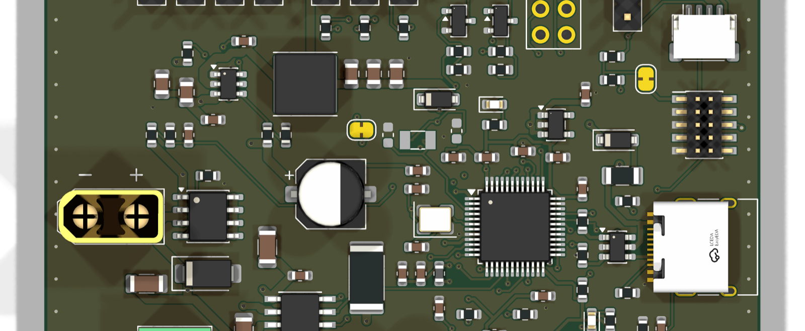
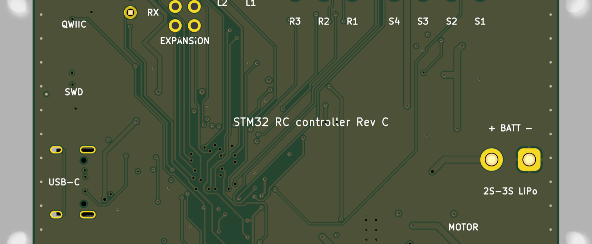

# Layout and Routing



## Board setup

- 70 × 50 mm, 2 mm corner radius, four M3 holes in the corners.
- 4 layers, 1.6 mm (JLCPCB standard stack-up):

| Layer | Use |
|---|---|
| F.Cu | components, signals, GND pour |
| In1.GND | solid ground plane (no tracks) |
| In2.Cu | signals, remaining area filled with GND |
| B.Cu | signals, GND pour, bottom silkscreen with the pinout |

- Design rules (`stm32_prototype.kicad_dru`) follow JLCPCB's standard capabilities: 0.127 mm track/space minimum,
  0.3 mm via drill, 0.5 mm hole-to-hole, 0.3 mm copper-to-edge.
- Net classes:

| Class | Nets | Track | Clearance |
|---|---|---|---|
| Default | signals | 0.2 mm | 0.15 mm |
| Supply | +3V3, GND, VDDA, VBAT_RTC | 0.3 mm | 0.15 mm |
| Power | +5V, VBUS | 0.5 mm | 0.2 mm |
| HighCurrent | VBAT, V5_SERVO, motor outputs, buck switch node | 0.8 mm | 0.2 mm |
| USB | D+/D− | 0.3 mm, 0.15 mm gap | 0.15 mm |

The 0.15 mm clearance is needed to escape the LQFP-48; JLCPCB's minimum is 0.127 mm.

## Placement

The board is organised in zones, scripted in `scripts/revc_board.py`:

- **Top edge:** 4 servo outputs, 3 receiver inputs, 2 light outputs, UART, expansion header, all pin headers in one
  row so cables leave in the same direction.
- **Left:** XT30 battery input, reverse-protection FET, TVS and bulk capacitors, then the buck converter with its
  inductor close to the servo headers.
- **Bottom left:** motor driver with its bulk capacitors and shunt, motor screw terminal at the board edge.
- **Centre:** MCU with decoupling capacitors 2–4 mm from their VDD pins and the crystal 3–5 mm from PD0/PD1.
- **Right edge:** USB-C, ESD protection, USB series resistors, LDO, Cortex-Debug, Qwiic.
- **Bottom right:** BOOT0 and RESET buttons, IMU near the centre line of the board.

## Routing

Routing is automated with [Freerouting](https://github.com/freerouting/freerouting) (`scripts/route_revb.sh`):

1. The board is exported to Specctra DSN with GND as a plane on In1.
2. A Freerouting rules file makes In1 30 times more expensive than the other layers, so the router only drops vias
   into it and the plane stays one solid piece.
3. Vias are modelled 0.7 mm wide during routing so that via centres stay ≥ 0.85 mm apart (JLCPCB: 0.5 mm
   hole-to-hole between different nets).
4. After import, GND pours are added on all layers, every SMD ground pad gets a via, and stitching vias run
   along the board edge.
5. The silkscreen step hides the crowded top designators and prints connector functions and the pinout on the bottom.



## Checks

```bash
kicad-cli pcb drc --severity-all --exit-code-violations --schematic-parity stm32_prototype/stm32_prototype.kicad_pcb
```

Result: 0 violations, 0 unconnected items, 0 schematic-parity issues. The In1 ground plane is a single island.

## 3D models

KiCad 10 ships no 3D models for the HRO USB-C receptacle, the XT30 connector and the TS-1187A buttons, and the
DRV8870 footprint points to a misnamed file. `scripts/apply_3d_models.py` assigns STEP models from LCSC/EasyEDA
(downloaded with `easyeda2kicad` by LCSC number, stored in `stm32_prototype/3dmodels/`) and KiCad's HSOP-8 body.
Parts marked *Do not populate* (optional crystal, expansion header) are hidden in the 3D view on purpose.
